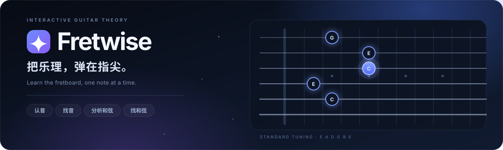

<div align="center">
  
  <p><b>一块指板，四种练习。</b><br>在浏览器里练音名、音程、音阶与和弦，打开即用。</p>
  <p>
    <a href="https://github.com/MORRR12345/Guitar-Practice"></a>
    
    
    
    
  </p>
</div>

**Fretwise** 是一个运行在浏览器里的吉他乐理练习工具。它把音名、音程、音阶与和弦放到一块可交互的 6 弦指板上：不背谱、不装 App，打开页面就能练。

项目由纯静态文件组成——没有框架、没有构建步骤、没有后端。克隆后启动任意静态服务器即可使用，也非常适合发布到 GitHub Pages。

## 目录

- [项目简介](#项目简介)
- [功能](#功能)
- [界面预览](#界面预览)
- [快速开始](#快速开始)
- [练习建议](#练习建议)
- [项目结构](#项目结构)
- [技术说明](#技术说明)
- [部署到 GitHub Pages](#部署到-github-pages)
- [已知限制](#已知限制)
- [路线图](#路线图)
- [参与贡献](#参与贡献)
- [许可证](#许可证)

## 项目简介

Fretwise 把学习拆成两个动作：**看见位置**，然后**说出它是什么**。指板是地图，题目是坐标；每一次点击都会立刻得到解释，让音名与品位在反复练习中建立联系。

### 为什么叫 Fretwise

`fret` 是吉他指板上的一格，`-wise` 表示「对……熟悉、在行」（如 streetwise、bookwise）。Fretwise 合起来就是「对指板了如指掌」——正是这个练习想帮你达到的状态：把音名、音程、音阶从纸面搬到指板上，让每一个位置都变得眼熟。

## 功能

> 🎯 四种练习模式 · ⚙️ 三项练习设置 · 📈 本地成绩记录

| 模式 | 练习内容 | 作答方式 |
| :---: | --- | :---: |
| 🎯 **找音**<br>`Locate` | 给出音名，在 6 弦指板上找到任意正确位置 | 点击指板 |
| 🔍 **认音**<br>`Identify` | 高亮一个位置，根据标准调弦回答音名 | 选择选项 |
| 📐 **音程**<br>`Interval` | 根据根音与音程名称，计算目标音 | 选择选项 |
| 🎼 **音阶与和弦**<br>`Explore` | 选择根音与结构，观察它们在指板上的分布 | 自由探索 |

支持大调、自然小调、大调五声音阶，以及大、小三和弦；每次探索都会在指板上标出根音与组成音。

| 设置 | 可选值 |
| :---: | --- |
| 🎸 **指板范围** | 0–5 品（入门）· 0–12 品（标准） |
| 🎹 **音名范围** | 自然音 C D E F G A B · 全部 12 个半音 |
| 🔤 **音名显示** | 音名（C D E F G A B）· 唱名（1 2 3 4 5 6 7） |
| 📈 **练习记录** | 本轮成绩与累计正确率，保存在浏览器 localStorage |

音名与唱名切换后，指板、题面与解析会一起变化。指板按抱琴视角绘制，1 弦在上、6 弦在下；变化音统一使用升号表示。

## 界面预览

<p align="center">
  
  <br>
  <sub>找音模式 · 0–12 品 · 自然音</sub>
</p>

## 快速开始

> [!NOTE]
> 项目使用原生 ES Modules，需要通过 HTTP 访问。直接双击 `index.html` 会被浏览器的模块加载策略拦截。

| 环境 | 版本 | 用途 |
| :--- | :--- | :--- |
| 浏览器 | 支持 ES Modules 的现代浏览器 | 运行页面 |
| Python | 3.x，或任意静态文件服务器 | 本地预览 |
| Node.js | 18+ | 仅运行测试 |

```bash
# 1. 获取代码
git clone https://github.com/MORRR12345/Guitar-Practice.git
cd Guitar-Practice

# 2. 启动静态服务器
python -m http.server 8000
```

打开 <http://localhost:8000/> 即可开始练习。项目没有运行时依赖，**不需要** `npm install`，也**不需要**构建。

运行乐理规则测试：

```bash
npm test
```

测试使用 Node.js 内置的 `node:test`，覆盖标准调弦、指板范围、音程与和弦计算、出题逻辑，以及音名 / 唱名切换。

## 练习建议

| 阶段 | 推荐设置 | 目标 |
| :---: | --- | --- |
| 🌱 **入门** | 0–5 品 · 自然音 | 熟悉空弦与常用把位 |
| 🌿 **进阶** | 0–12 品 · 全部半音 | 掌握完整指板与升号 |
| 🎼 **应用** | 音阶与和弦探索 | 观察大调、小调、五声与三和弦的分布 |
| 🧠 **巩固** | 切换为唱名 | 建立音级与唱名的联系 |

## 项目结构

```text
.
├─ index.html                 页面结构与语义标记
├─ style.css                  视觉设计与响应式布局
├─ src/
│  ├─ main.js                 页面状态、交互与成绩
│  ├─ music-theory.js         音高、音程、音阶与和弦计算
│  ├─ exercises.js            出题与答案解析
│  ├─ fretboard.js            可交互 SVG 指板
│  └─ storage.js              浏览器本地存储
├─ tests/
│  └─ music-theory.test.js    乐理规则测试
├─ assets/
│  ├─ banner.svg              README 横幅
│  └─ preview.png             README 界面预览
├─ package.json               测试脚本；网页运行不依赖它
└─ LICENSE                    MIT 许可证
```

## 技术说明

| 层 | 方案 | 说明 |
| :---: | --- | --- |
| 结构 | 原生 HTML | 语义化标签与无障碍属性 |
| 样式 | 原生 CSS | 响应式布局、系统字体、克制的动效 |
| 交互 | 原生 JavaScript（ES Modules） | 无框架、无构建步骤 |
| 指板 | SVG | 每个位置直接绑定弦号与品位，点击无需根据坐标猜测 |
| 存储 | localStorage | 记录仅保存在当前浏览器 |

乐理运算以 12 个半音为基础，全部在浏览器内完成，不需要后端。前端代码保持模块化：乐理、出题、指板与存储各自独立，方便单独测试与扩展。

## 部署到 GitHub Pages

1. 将仓库推送到 GitHub。
2. 打开仓库的 **Settings → Pages**。
3. 在 **Build and deployment** 中选择 **Deploy from a branch**，选择发布分支与 **/(root)** 目录并保存。
4. 等待 Pages 给出访问地址。

> [!TIP]
> 页面使用相对资源路径，天然适配仓库子路径，无需修改任何配置。

## 已知限制

- 变化音统一使用升号表示，暂未支持降号、同音异名与五线谱拼写。
- 仅支持标准调弦（E A D G B E）。
- 练习记录只保存在当前浏览器的 localStorage 中，清除浏览器数据后会丢失，也不会跨设备同步。

## 路线图

- [x] 指板找音、位置认音、音程计算、音阶与和弦探索
- [x] 自然音 / 全部半音、音名 / 唱名切换
- [x] 本轮与累计成绩记录
- [ ] 更完整的降号、同音异名与调性拼写
- [ ] 分级课程、错题复习与更细的进度统计
- [ ] 更多和弦类型、常见指型与听音练习

## 参与贡献

1. Fork 仓库并创建分支：`git checkout -b feat/your-idea`
2. 完成修改；如果涉及乐理计算，请补充对应测试。
3. 运行 `npm test`，确认全部通过。
4. 提交 Pull Request，说明动机与改动。

Bug 与建议也欢迎通过 [Issues](https://github.com/MORRR12345/Guitar-Practice/issues) 提出。

## 许可证

本项目基于 [MIT License](./LICENSE) 开源。Copyright © 2026 [MORRR](https://github.com/MORRR12345)。

<div align="center">
  <br>
  <sub>把每一个音，练成肌肉记忆。</sub><br><br>
  <sub>Fretwise · Made with 🎸 by MORRR</sub><br>
  <sub>如果这个项目对你有帮助，欢迎点一个 ⭐ Star</sub>
</div>
