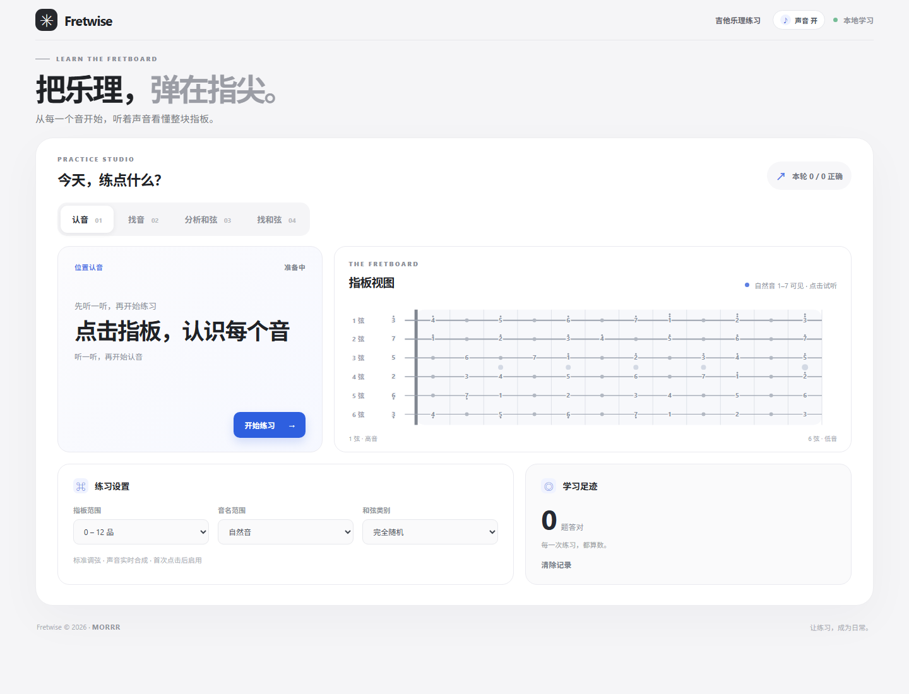
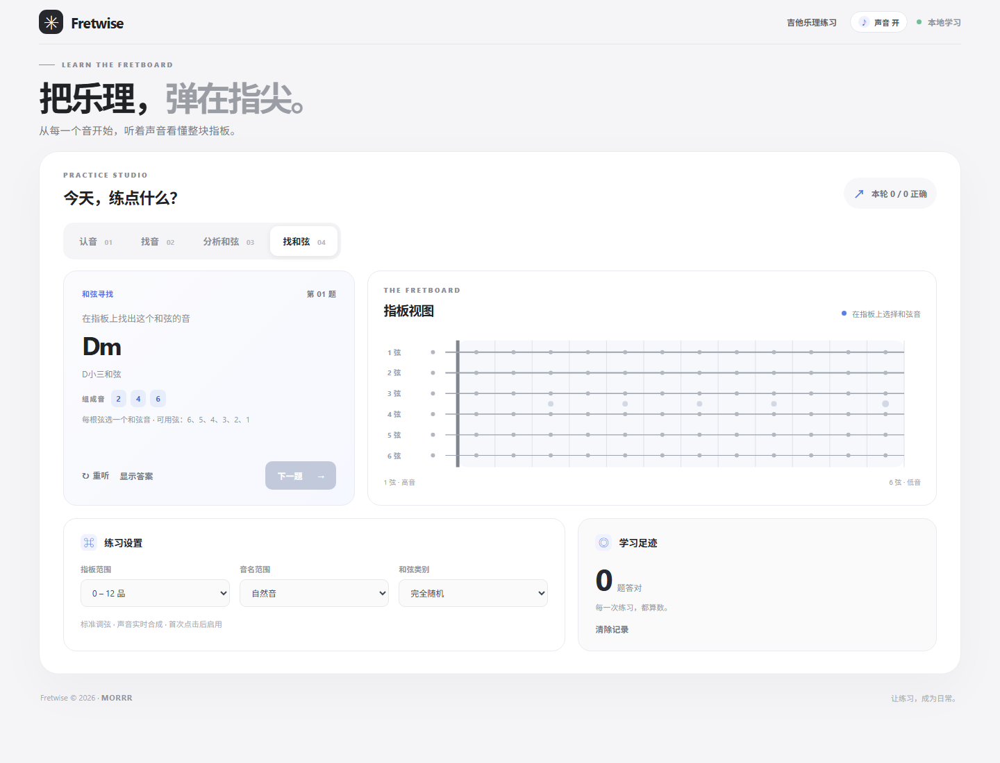

<div align="center">
  
  <p><b>会发声的吉他指板，四种练习。</b><br>听音、找音、分析和弦、寻找和弦。</p>
  <p>
    <a href="https://morrr12345.github.io/Fretwise/"></a>
    <a href="https://github.com/MORRR12345/Guitar-Practice"></a>
    
    
    
  </p>
</div>

**Fretwise** 是一个运行在浏览器里的吉他乐理练习工具。它以一块会发声的六弦指板为核心，把唱名、八度与和弦放回手指与耳朵之间。

项目为纯静态页面：无框架、无构建步骤、无后端，也不依赖任何音频文件。

## 使用

| 方式 | 入口 |
| :---: | --- |
| **在线使用** | [morrr12345.github.io/Fretwise](https://morrr12345.github.io/Fretwise/) |
| **本地运行** | [localhost:8000](http://localhost:8000/) |

### 在线使用

直接打开 **[https://morrr12345.github.io/Fretwise/](https://morrr12345.github.io/Fretwise/)**，无需安装或配置。

### 本地运行

项目使用原生 ES Modules，需要通过 HTTP 访问。使用任意静态文件服务器即可，例如：

```bash
python -m http.server 8000
```

然后打开 **[http://localhost:8000/](http://localhost:8000/)**。

> 不要直接双击 `index.html`，浏览器会拦截模块加载。

## 功能

| 模式 | 说明 |
| :---: | --- |
| **认音** | 听一个位置的真实音高，选择唱名。 |
| **找音** | 按目标音高与八度，在指板上找到对应位置。 |
| **分析和弦** | 听一组和弦音，从吉他符号中选出正确的和弦。 |
| **找和弦** | 按吉他符号、中文名称与组成音，逐弦找出和弦音。 |

指板默认标注自然音 `1–7` 与八度点；遇到变化音时使用 `♯1`、`♯2` 等数字。和弦名称采用 `Em`、`Cmaj7`、`G7`、`Dsus4` 这类吉他习惯写法，后接中文名称。

## 特点

- **会发声的指板**：Karplus-Strong 实时合成拨弦音，点击即听，无需加载音频文件。
- **吉他记谱**：5 弦 3 品写作 `C4`，界面按吉他习惯高一个八度显示，声音保持实际音高。
- **和弦练习**：可按大三、小三、七和弦、挂四或完全随机筛选，分析和弦与找和弦共用。
- **零依赖**：原生 HTML / CSS / JavaScript，打开即用，适配桌面与移动端。

## 界面预览

<p align="center">
  
  
  <br>
  <sub>指板 · 唱名与八度　|　找和弦 · 吉他符号与组成音</sub>
</p>

## 项目结构

```text
src/      页面逻辑、SVG 指板、乐理、出题与音频合成
assets/   横幅、站点图标与预览图
tests/    乐理、出题与音频测试
```

## 本地测试

```bash
npm test
```

需要 Node.js 18 或更高版本。测试不依赖浏览器。

## 技术

原生 HTML、CSS 与 JavaScript（ES Modules）；声音由 Web Audio API 的 Karplus-Strong 合成；指板为 SVG；练习记录保存在浏览器 localStorage。

## 反馈

欢迎通过 [Issues](https://github.com/MORRR12345/Guitar-Practice/issues) 提出建议或报告问题。

## 许可证

[MIT License](./LICENSE) · Copyright © 2026 [MORRR](https://github.com/MORRR12345)
